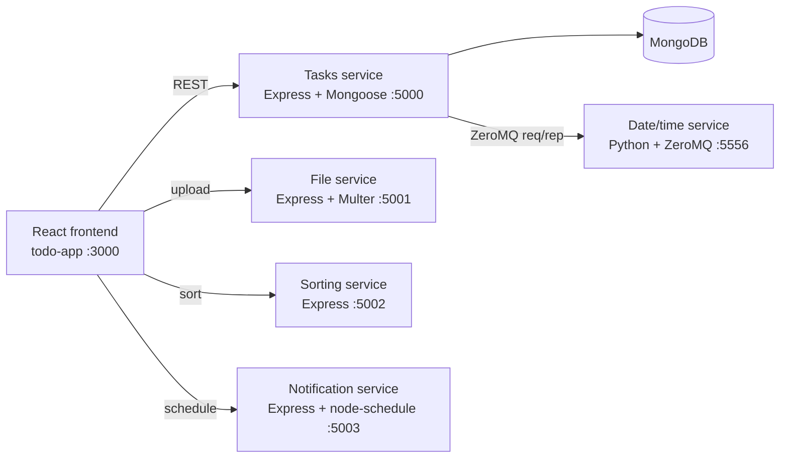

# ORNG Tasks

A full-stack to-do app built on a **microservice architecture**. A React frontend talks to five small, independent backend services. Each one owns a single job: tasks, file uploads, sorting, notifications, and the date/time. Built for CS 361 (Software Engineering I) at Oregon State University.


## Features

- **Task management**: create, edit, complete, and delete tasks, stored in MongoDB
- **Multiple lists**: switch between Main, Work, and Personal, or add your own
- **Priorities**: tag tasks High, Medium, or Low, then sort by priority or title
- **Due dates and reminders**: set a due date and time and get an alert when it arrives
- **File attachments**: attach a file (up to 10 MB) to any task
- **Live clock**: the header shows the current time from a Python microservice
- **Settings page**: show or hide completed tasks

## Architecture



| Service | Folder | Port | What it does |
|---|---|---|---|
| Frontend | `todo-app/` | 3000 | React 19 + React Router UI |
| Tasks | `tasks-service/` | 5000 | CRUD API for tasks; proxies `/time` to the date/time service |
| Files | `file-service/` | 5001 | Accepts uploads and serves them back by URL |
| Sorting | `sorting-service/` | 5002 | Sorts by title or priority; filters active/completed |
| Notifications | `notification-service/` | 5003 | Schedules a reminder at a task's due time |
| Date/time | `microservices/datetime-server.py` | 5556 | Returns the formatted current time for a requested time zone over ZeroMQ |

## Tech stack

**Frontend:** React 19, React Router, Axios
**Backend:** Node.js, Express 5, Mongoose, Multer, node-schedule
**Other:** MongoDB, Python 3, ZeroMQ (`zeromq` / `pyzmq`)

## Getting started

### Prerequisites

- Node.js 18+
- Python 3.9+
- A MongoDB database (local, or a free MongoDB Atlas cluster)

### 1. Install dependencies

```bash
git clone https://github.com/loganjmoskal/orng-tasks.git
cd orng-tasks

# root dependencies (used by tasks-service and the frontend)
npm install

# each service and the frontend
cd file-service && npm install && cd ..
cd sorting-service && npm install && cd ..
cd notification-service && npm install && cd ..
cd todo-app && npm install && cd ..

# Python date/time service
pip install pyzmq tzdata
```

### 2. Configure MongoDB

Create `tasks-service/.env`:

```env
MONGO_URI=mongodb://localhost:27017/orng-tasks
```

### 3. Run everything

Each service runs in its own terminal:

```bash
python microservices/datetime-server.py           # date/time  :5556
cd tasks-service && node server.js                # tasks      :5000
cd file-service && node index.js                  # files      :5001
cd sorting-service && node index.js               # sorting    :5002
cd notification-service && node index.js          # reminders  :5003
cd todo-app && npm start                          # frontend   :3000
```

Then open http://localhost:3000.

## API reference

### Tasks service (`:5000`)

| Method | Endpoint | Description |
|---|---|---|
| `GET` | `/tasks?list=Work` | Tasks in a list (defaults to `Main`) |
| `GET` | `/tasks?all=true` | All tasks across every list |
| `POST` | `/tasks` | Create a task: `{ title, priority, dueDate, attachment, listName }` |
| `PUT` | `/tasks/:id` | Update title, completed, priority, due date, or attachment |
| `DELETE` | `/tasks/:id` | Delete a task |
| `GET` | `/time` | Current time from the date/time microservice |

### Other services

| Service | Method | Endpoint | Body |
|---|---|---|---|
| Files | `POST` | `/upload` | `multipart/form-data` with a `file` field |
| Sorting | `POST` | `/sort` | `{ tasks, sortBy: "title_asc" \| "title_desc" \| "priority" }` |
| Sorting | `POST` | `/filter` | `{ tasks, filterBy: "active" \| "completed" }` |
| Notifications | `POST` | `/schedule` | `{ taskId, taskTitle, dueTime }` |
| Date/time (ZeroMQ) | — | `tcp://localhost:5556` | `{ timeZone: "pst", textDate: true, militaryTime: false }` |

## Project structure

```
orng-tasks/
├── todo-app/               # React frontend
│   └── src/
│       ├── App.jsx         # routes
│       ├── TaskList.jsx    # main task view
│       └── Settings.jsx    # preferences page
├── tasks-service/          # task CRUD API + MongoDB model
├── file-service/           # file uploads
├── sorting-service/        # sort and filter
├── notification-service/   # due-date reminders
└── microservices/
    └── datetime-server.py  # Python date/time service (ZeroMQ)
```

## Known limitations

- Custom lists live in frontend state, so they reset on refresh (tasks themselves are saved).
- Reminders show as a browser alert and a server log rather than system notifications.
- Service URLs are hard-coded to `localhost`, so the app runs locally only.
